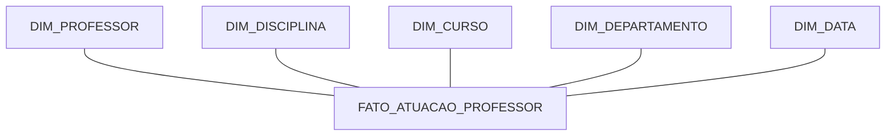

# Modelo Dimensional — Star Schema

## Objetivo

Construir um modelo dimensional para análise da atuação dos professores, considerando disciplinas ministradas, cursos e departamentos.

## Granularidade

Cada registro da tabela fato representa uma combinação de professor, disciplina, curso e data de oferta.

## Diagrama do modelo

## Tabela fato

**FATO_ATUACAO_PROFESSOR**

- ProfessorKey
- DisciplinaKey
- CursoKey
- DepartamentoKey
- DataKey
- QuantidadeDisciplinas
- CargaHoraria

## Dimensões

- **DIM_PROFESSOR:** identificação e informações dos professores.
- **DIM_DISCIPLINA:** identificação e informações das disciplinas.
- **DIM_CURSO:** identificação e informações dos cursos.
- **DIM_DEPARTAMENTO:** nome, campus e identificação do departamento.
- **DIM_DATA:** data, dia, mês, trimestre, semestre e ano.

## Premissas e limitações

O diagrama relacional de origem não apresenta datas de oferta nem carga horária. Esses atributos deverão ser obtidos de uma fonte complementar ou simulados para fins didáticos, com essa condição devidamente documentada.

As tabelas de alunos e matrículas foram excluídas por não fazerem parte do foco analítico solicitado no desafio.

## Observação

Este é o modelo conceitual inicial. Os campos e relacionamentos deverão ser validados antes da implementação definitiva.
